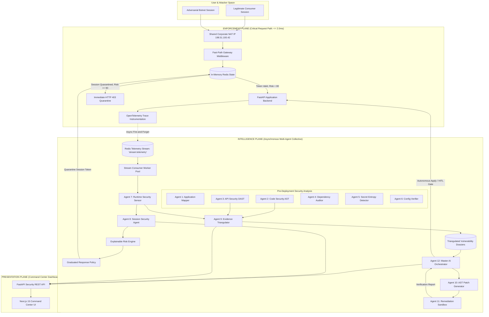
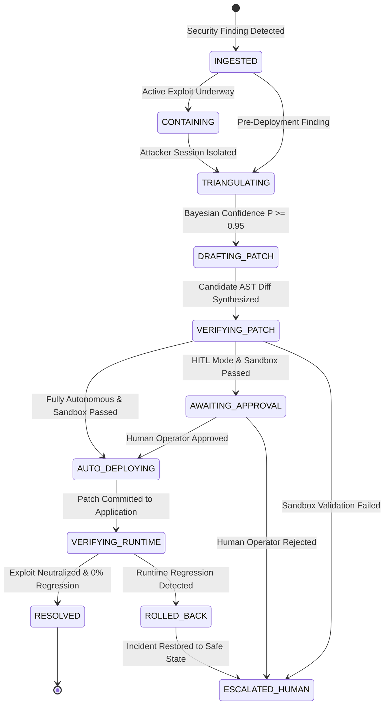

# CyberShield Architecture & System Design Document

**A Multi-Agent AI System for E-Commerce Application Security Analysis, Runtime Threat Detection, Graduated Containment, and Automated Response**

---

## 1. High-Level Architecture Overview

CyberShield implements a **Dual-Plane Multi-Agent Architecture** that cleanly separates critical-path request enforcement from asynchronous multi-agent intelligence and analysis:

---

## 2. The 12 Specialized Autonomous Agents

| Agent ID | Agent Name | Operating Plane | Core Responsibility | Key Inputs | Primary Outputs |
| :--- | :--- | :--- | :--- | :--- | :--- |
| **Agent 1** | **Application Mapper** | Pre-Deployment | AST & router reflection discovering API attack surface | Python source code | Application route map, models, auth classification |
| **Agent 2** | **Code Security Agent** | Pre-Deployment | Deterministic AST analysis for injection & authorization flaws | Python AST trees | SAST vulnerability findings (CWE-89, CWE-284, CWE-840) |
| **Agent 3** | **API Security Agent** | Dynamic Pre-Deploy | Black-box DAST probing and OpenAPI conformance testing | Running API endpoints | DAST reproduction traces, exploit payloads |
| **Agent 4** | **Dependency Security** | Pre-Deployment | Software Bill of Materials (SBOM) and advisory auditing | `pyproject.toml` | Vulnerable dependency reports |
| **Agent 5** | **Secret Security Agent** | Pre-Deployment | Shannon entropy calculation & regex credential detection | Code repository | High-entropy secrets, redacted tokens |
| **Agent 6** | **Configuration Security**| Pre-Deployment | Audit of environment settings, CORS, and debug flags | `config.py`, `.env` | Configuration weakness findings |
| **Agent 7** | **Runtime Security Agent**| Live Runtime | Telemetry stream ingestion and exploit pattern matching | Redis OTel streams | Runtime security incident records |
| **Agent 8** | **Session Security Agent**| Live Runtime | Multi-signal behavioral profiling & explainable risk scoring | Runtime incidents | 0–100 risk score, graduated containment state |
| **Agent 9** | **Evidence Triangulator** | Cross-Plane | Mathematical Bayesian evidence fusion ($P \ge 0.99$) | SAST + DAST + Runtime | Triangulated vulnerability dossiers |
| **Agent 10**| **Automated Remediation** | Response & Repair | Deterministic AST patch drafting (parameterization, gates) | Dossier, source file | Unified AST code diffs |
| **Agent 11**| **Sandbox Verification**  | Response & Repair | Pre-commit isolated syntax, safety, and regression checks | AST diff, source file | Verification report ($100\%$ valid, $0\%$ regression) |
| **Agent 12**| **AI Orchestrator**       | Master Lifecycle | Finite State Machine workflow coordination, RCA, playbooks| All agent events | Incident workflows, RCA reports, audit logs |

---

## 3. Incident State Machine & Transition Rules

Agent 12 enforces a strict Finite State Machine (`IncidentStateMachine`) governing the lifecycle of discovered security incidents:

---

## 4. Graduated Containment Tiers

Session risk scores compounded by Agent 8 are mapped to graduated response tiers:

| Tier Name | Risk Score | Min Confidence | Action Taken | User Impact |
| :--- | :---: | :---: | :--- | :--- |
| **`ALLOW`** | 0 – 29 | 0.00 | Unrestricted processing | Normal legitimate shopping experience |
| **`MONITOR`** | 30 – 59 | 0.50 | 100% telemetry sampling rate | Zero user interruption |
| **`THROTTLE`** | 60 – 79 | 0.65 | Token bucket rate limiting (delay injection) | Attacker slowed down; benign users unaffected |
| **`CHALLENGE`** | 80 – 89 | 0.75 | Step-up re-authentication / CAPTCHA | Adversary automation broken |
| **`CONTAIN`** | 90 – 100 | 0.85 | Immediate JWT JTI revocation in Redis | Session dropped at fast-path in $\le 1.25\text{ms}$ |

---

## 5. Bayesian Evidence Triangulation Formula

The core mathematical innovation of CyberShield's correlation engine is the multi-pillar Bayesian combination of independent evidence sources:

$$P(V) = 1.0 - \prod_{k=1}^{n} (1.0 - c_k)$$

- **Pillar 1 ($c_1$):** Static AST syntax analysis ($c_1 = 0.95$)
- **Pillar 2 ($c_2$):** Dynamic black-box HTTP probing ($c_2 = 0.92$)
- **Pillar 3 ($c_3$):** Runtime OpenTelemetry error telemetry ($c_3 = 0.98$)

**Triangulated Composite Confidence:**
$$P(V) = 1.0 - (1 - 0.95)(1 - 0.92)(1 - 0.98) = 1.0 - 0.00008 = 0.99992$$

This guarantees that benign queries triggering false alarms in single-pillar keyword regexes (such as *"Select leather wallet"*) never escalate to automated remediation or containment.
